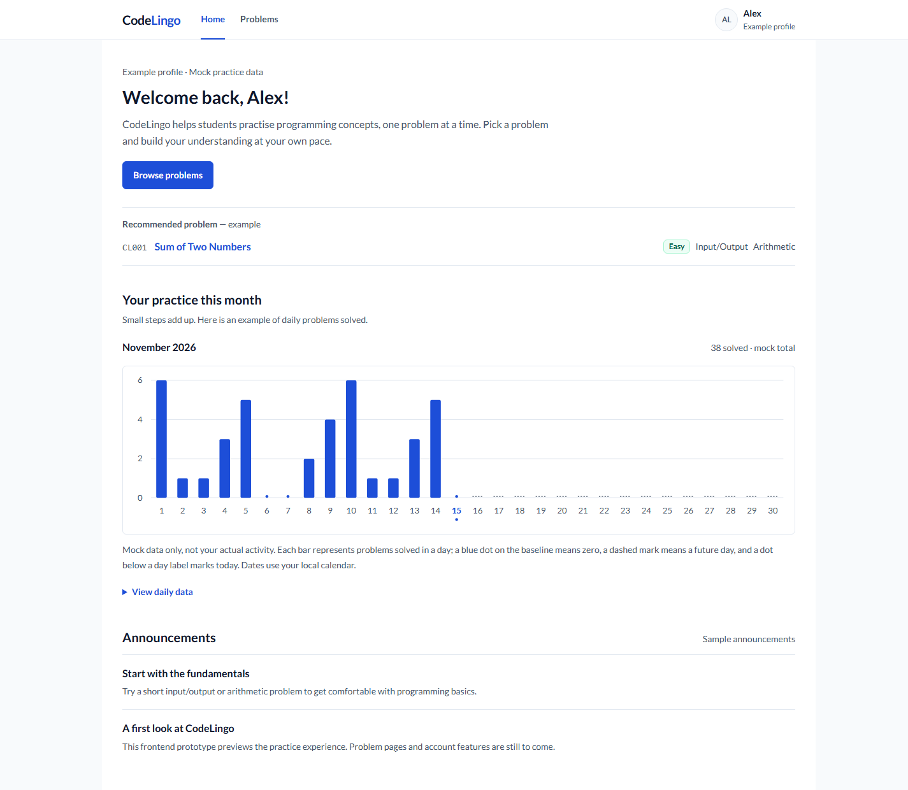
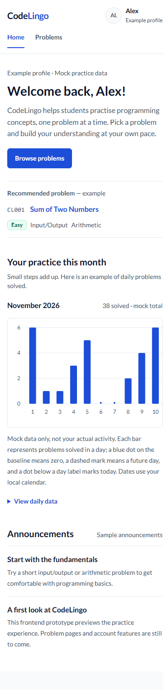

# Homepage PR notes

Suggested title: `feat(home): add practice dashboard and shared design foundation`

## Summary

Replace the Next.js starter with CodeLingo's static homepage and shared page shell.
The homepage introduces programming practice, links to the problem list and one
example problem, shows mock daily solved counts for the current local month, and
finishes with sample announcements.

The revised header contains Home, Problems, and a labelled example profile.
Submissions and account actions are deferred. `/problems` and `/problems/CL001`
remain future routes and currently return 404, as agreed. No authentication, API,
database, submission processing, or new dependencies are introduced.

## Design conventions

The root layout owns the header, main landmark, and centered 1120px white content
shell. Surrounding space is pale grey. Use Lato 400/700, 28px page headings, 20px
section headings, slate text, blue actions, 4px-based spacing, subtle dividers,
and 6px control corners. Reuse the shared tokens and small components rather than
adding page-specific global styles. The [design guide](design-foundation.md)
includes component examples, route conventions, chart behavior, and coordination
guidance for teammates.

## Related issue

Add the assigned issue number when opening the PR; no issue number was supplied
with this implementation request.

## Screenshots and verification

- `npm run lint`: passed.
- `npm run build`: passed, including TypeScript and static prerendering. The build
  used network access to fetch Lato through Next.js; no package was installed.
- Production HTTP check: `/` returns 200 and includes the expected introductory
  content, profile labels, navigation, and example problem link. The two agreed
  future destinations return 404.
- Headless Chrome: checked 1440px desktop, 768px tablet, 375px mobile, and 320px
  narrow layouts. No page-level horizontal overflow or browser exceptions. Chart
  scrolling stays inside its own region; the current month and daily rows render.
  The data table expands, Home is marked active, and the first Tab focuses the
  visible skip link with an outline. Desktop, tablet, and mobile captures were
  visually inspected.
- Calendar checks: passed for 28-, 29-, 30-, and 31-day months, including leap year,
  first/middle/last day, deterministic integer counts from zero to six, unique
  dates, actual mock zero counts, and future dates marked as no data.
- Browser checks used installed Chrome and a temporary dependency-free script;
  no browser testing dependency or package configuration was added.

### Desktop

### Mobile

Additional captures: [tablet](screenshots/home-tablet.png) and
[320px narrow layout](screenshots/home-narrow.png).
